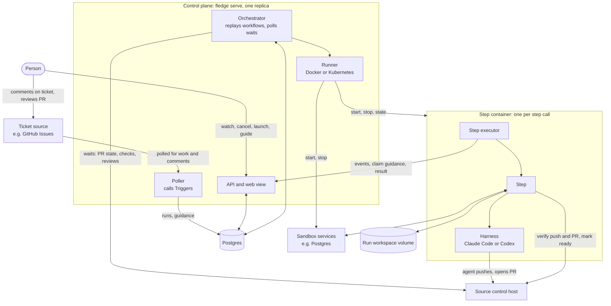

# Fledge MVP architecture

Status: implemented for Docker. Scope: the smallest factory that works end to
end. A ticket goes in, agents work on it, a pull request comes out and is
followed until it is merged, and a person can watch and steer.

Build order: the first implementation is Docker only. The Kubernetes runner and
manifests are designed here and deferred to a follow-up task. The design keeps
both platforms in view so that task adds one runner and nothing else.

## Summary

Fledge is one control-plane process plus one short-lived container per step.

- The **control plane** (`fledge serve`) polls triggers, advances runs by
  replaying their workflow functions, polls the waits runs are blocked on, and
  serves the API and web view. All of its state is in Postgres.
- Each **step** runs in its own container (`fledge step-exec`), with any
  services its sandbox asks for next to it. Steps in one run share a workspace
  volume, which holds the run's repositories and each agent's session. The
  step container talks back to the control plane over HTTP to report events,
  collect guidance and post its result.
- The **runner** is the only platform-specific code: a Docker implementation
  first, and a Kubernetes implementation later, behind one small interface.

Choices made here, with the reason for each:

| Choice | Reason |
| --- | --- |
| Python 3.13, one package (`fledge`) | The repo is already set up for it, and extension authors write plain Python. |
| A workflow is a Python function, replayed against a journal of its calls | Loops and branches are Python, and steps hand each other values as arguments and results. Replaying from recorded results means a suspended run holds no process, thread or container. |
| Workflows are Python files in a directory the control plane loads | A workflow and the trigger that feeds it are one value, and changing one needs a restart, not a rebuild. |
| Each run carries a snapshot of the workflow code | The control plane replays, and step containers import, the snapshot the run started with, even if the directory changes mid-run. |
| One image for the control plane and every step | Guarantees the same tools and libraries everywhere. Teams extend it with `FROM`. |
| Step containers report over HTTP, not by connecting to Postgres | Keeps database credentials out of the container the agent runs in, and makes Docker and Kubernetes behave the same. |
| A per-run workspace volume shared by the run's steps | Steps hand repositories and agent sessions to each other on disk, so an agent's session survives from one container to the next. |
| Work happens in containers; waiting happens in the control plane | A run waiting on CI or a person holds no container. The concurrency limit is on step containers, not runs. |
| Agents do the git work; the workflow says when, and Fledge verifies | Committing, merging in other people's commits and writing the pull request need judgement. |
| Postgres is also the queue | Runs are rows with a status. No broker. |
| Single control-plane replica | Removes leader election and locking. The loop is a reconciler, so a restart resumes from the database. |
| GitHub only for the built-in trigger and pull request functions | One working path. Other trackers and hosts are custom triggers, steps and waits. |
| FastAPI, psycopg 3, plain SQL migrations, server-rendered HTML | Small, typed, no ORM and no frontend build. |

Runtime dependencies: `fastapi`, `uvicorn`, `jinja2`, `psycopg`, `pydantic`,
`pydantic-settings`, `httpx`, `docker`. The Kubernetes task adds `kubernetes`.

## 1. Components

| Component | Responsibility | Extension point? |
| --- | --- | --- |
| Trigger | Finds outside work to react to by polling, fetches one ticket on request, and finds new human comments on a ticket. | Yes |
| Workflow | A function with its trigger, written in the workflows directory. It calls steps, agents and checks, and decides from their results. | Yes |
| Step | A function run in its own container against the run's workspace, with JSON arguments and result. | Yes |
| Check | Something `until` evaluates: a `@check` runs in a container like a step, a `@wait` is polled by the control plane. Each returns passed, feedback or (for a wait) pending or stopped. | Yes |
| Agent | A named harness with a sandbox and a session that lasts the run. Prompting it is a call of the built-in `run_turn` step. | A value, not an interface |
| Harness | Adapter around one coding agent CLI. Runs one agent turn, resumes a session from a state directory, and can return a structured answer. | Yes |
| Sandbox | Services and environment variables for the containers of an agent, step or check. | A value, not an interface |
| Poller | Calls each workflow's trigger on an interval. Creates runs for new work and guidance rows for new comments. | Fixed |
| Replay engine | Calls a workflow function against its run's journal, returning recorded results and suspending at the first call without one. | Fixed |
| Orchestrator | Reconcile loop. Replays each running run, starts the step it suspends on (up to the step container limit), polls the wait it suspends on, records outcomes, handles cancel and timeouts. | Fixed |
| Runner | Creates the run workspace, starts and stops step containers and their services, reports container state. Docker first; Kubernetes deferred. | Fixed |
| Step executor | Entrypoint inside the step container (`fledge step-exec`). Imports the run's workflow snapshot, finds the step, waits for the sandbox's services, runs the step, reports the result. | Fixed |
| API and web view | Public API for runs, cancel, guidance and manual launch. Internal API for step containers. The web view is a thin page over the public API. | Fixed |
| Store | Postgres schema and queries. | Fixed |
| CLI | `fledge serve`, `fledge init`, `fledge step-exec`, `fledge migrate`, `fledge submit`. | Fixed |

Shipped extensions:

- Trigger: `GitHubIssues` (open issues in one repo carrying a configured label).
- Steps: `clone_repo` (`fledge.steps`) and `mark_ready` (`fledge.github`).
- Checks: `command` (`fledge.checks`), `Agent.approves`, and the waits
  `checks_green` and `merged` (`fledge.github`).
- Pull request calls: `open_pull_request` and `push` (`fledge.github`), each an
  agent prompt followed by a verifying step.
- Harnesses: `ClaudeCode` and `Codex` (`fledge.harnesses`).
- `fledge init --repo owner/name` writes a workflow that takes each labelled
  issue to a merged pull request with one Claude Code agent. There is no
  shipped workflow: a workflow needs a trigger, and a trigger needs a
  repository.

## 2. How the components interact



### Life of a run

1. **Detect.** The poller calls `poll()` on each workflow's trigger. For each
   returned work item it inserts a `pending` run unless a run already exists for
   the same workflow and external id. The run records the hash of the workflow
   snapshot loaded at startup. A manual launch (web box or `fledge submit`)
   calls the trigger's `fetch()` and always inserts a run.
2. **Start.** On its next tick the orchestrator moves every `pending` run to
   `running`. Runs are not capped. The first time it reconciles a run it asks
   the runner to create the run's workspace.
3. **Replay.** Every tick (two seconds), for each running run, the
   orchestrator loads the workflow from the run's snapshot and calls the
   function with the run's journal: its `step_runs` rows in call order. Each
   step or wait the function calls is matched to the journal by position. A
   call with a recorded result returns it; a failed step raises `StepFailed`
   in the workflow. The first call without a result suspends the function by
   raising through it, and the orchestrator acts on that call. If the call
   recorded at a position names a different function, the run fails rather
   than return the wrong result.
4. **Step.** If the run is suspended on a step and fewer than
   `FLEDGE_MAX_CONCURRENT_STEPS` step containers are running across all runs,
   the orchestrator inserts a `step_runs` row with the call's position,
   function and arguments and a fresh token, and asks the runner to start a
   container with the sandbox's services next to it. The container gets the
   configured secrets, the sandbox's environment, three settings (API URL,
   step run id, token) and the services' ready ports. Otherwise the run stays
   suspended until a later tick.
5. **Execute.** Inside the container, the step executor fetches its context
   from the internal API (work item, the step's `module:qualname`, its
   arguments and the run's workflow snapshot), imports the snapshot, finds
   the step, waits until each ready port accepts a connection, rebuilds the
   arguments from the function's type hints and calls it. Log lines and
   harness events are posted back as events.
6. **Report.** The executor posts the step's JSON result, or an error, and
   exits. On the next tick the orchestrator sees the result in Postgres,
   removes the container and its services, and replays again: the call now
   returns its result and the function runs on to its next call. If the
   container exits without a result, or exceeds `FLEDGE_STEP_TIMEOUT_MINUTES`,
   the step is marked failed and the call raises `StepFailed` in the workflow.
7. **Wait.** If the run is suspended on a wait, the orchestrator inserts a
   `step_runs` row for it (no container) and, every
   `FLEDGE_POLL_INTERVAL_SECONDS`, calls the wait function in the control
   plane. Pending keeps the run suspended; any other verdict is recorded as
   the call's result and the next replay carries on from it.
8. **Finish.** When the function returns, the run is `succeeded`. When it
   raises, the run is `failed` with the exception as its error. When a check
   reports stopped (for example the pull request was closed unmerged), the
   run is `cancelled`. On any terminal status the runner deletes the
   workspace.

There is no retry. A failed run stays failed; a person can launch a new run for
the same ticket by hand. A workflow can catch `StepFailed` or
`RoundsExhausted` and carry on.

### Gates

`until(check, max_rounds=n)` evaluates the check. Passed ends the loop.
Feedback is yielded to the loop body, which normally prompts an agent with it,
and the check is evaluated again; after `n` rounds of feedback `until` raises
`RoundsExhausted`. Stopped raises `RunStopped`, a `BaseException`, which ends
the run as cancelled. Each evaluation is a new call in the journal, so a gate
that loops five times records five check calls.

A wait is given `since`: when its loop last received feedback, or started.
This time comes from the journal (the finish time of the latest call the
workflow has passed), so it is the same on every replay.

### Agents and sessions

`agent.prompt(prompt, repo)` is a call of the built-in step
`fledge.agents:run_turn`, shown under the agent's name and run with the
agent's sandbox. Its arguments are the agent's name, the prompt, the
repository and, with `returns=`, a reference to the result type. In the
container the step looks the agent up by name in the run's snapshot, so a
harness is never serialised.

Each agent has a directory in the workspace, `agents/<name>/`, outside every
repository. It holds the harness's state directory (`CLAUDE_CONFIG_DIR` for
Claude Code, `CODEX_HOME` for Codex) and the id of the agent's session. The
first prompt an agent gets in a run starts a session; every later one, in
whichever container, resumes it. A session that cannot be resumed fails the
call.

Before the turn, the step sets a commit identity and, when `GITHUB_TOKEN` is
set, runs `gh auth setup-git`, so the agent can fetch, push and use `gh` with
the token. The credential helper is in the container's own git config, so
the token is never written to the workspace.

With `returns=`, the step derives a JSON Schema from the type and the harness
asks the CLI for an answer matching it (`--json-schema` for Claude Code,
`--output-schema` for Codex). The step fails if the turn ends without one.
`Agent.approves` uses this with the `Review` type and maps `approved` to
passed and the comments to feedback.

### Sandboxes and services

A sandbox applies to every container started for its agent, step or check.
For a step with services the Docker runner creates a network for that step
run, starts each service on it, and starts the step container on both that
network and the control plane's, with an `/etc/hosts` entry mapping each
service name to its address. A service is reached by its name, never on
`localhost`. When the step ends the runner removes the container, the
services (found by a label carrying the step run id) and the network.
Nothing in a service survives from one call to the next.

The step executor waits up to 60 seconds for each service's `ready_port` to
accept a TCP connection before running the step, and fails the step if one
does not. The sandbox's environment variables are added to the container
after the step secrets. Every container runs the image Fledge is configured
with.

### Pull requests

`open_pull_request(agent, repo, draft=...)` prompts the agent to commit, push
the run's branch and open a pull request with `gh pr create`, then runs the
`verify_opened` step: the working tree is clean, the branch on `origin` is at
the local `HEAD`, and exactly one open pull request comes from the branch.
`clone_repo` names the branch (`fledge/<first 8 hex digits of the run id>`), so
Fledge finds the pull request itself. `push(agent, pr)` prompts the agent to
merge in anything new on the remote branch, commit and push, then verifies the
push the same way.

`mark_ready` is a step that calls GitHub directly. `checks_green(pr)` and
`merged(pr)` are waits:

- `checks_green` passes when the pull request is merged or its head commit's
  check runs and statuses have all finished without a failure. Failures are
  feedback, with the last 50 lines of the job log for GitHub Actions jobs. A
  commit with no checks at all counts as pending for two minutes after the
  loop starts, then as passed. A closed pull request stops the run.
- `merged` passes when the pull request is merged and stops the run when it
  is closed unmerged. Otherwise new reviews, review comments and conversation
  comments since `since`, and failing checks, are feedback. Comments by bots
  and by the account the token belongs to are ignored.

Nothing stops an agent pushing earlier than the workflow asks. The workflow's
calls are where publishing is requested and verified, not where it is
permitted.

### Steering

Guidance has two entry points and two delivery paths.

- From the web view: `POST /api/runs/{id}/guidance` inserts a guidance row.
- From where the work originated: while a run is active, the poller calls the
  trigger's `poll_guidance()` for that ticket and inserts a row for each new
  comment (deduplicated on the comment's external id).

During an agent prompt, `run_turn` claims the run's undelivered guidance from
the internal API after each harness turn. If there is any, it runs another
turn in the same session with the guidance as the prompt, and repeats until a
turn ends with nothing pending. A **turn** is one headless invocation of the
agent CLI, which runs until the agent stops and yields. There is no mid-turn
interruption.

While a run is suspended on a wait, the orchestrator claims guidance before
each poll. Guidance found there is recorded as the wait's result, as feedback
from "a person overseeing this work", so the gate's loop body hands it to an
agent. It counts as a round.

Guidance that arrives while a step without an agent runs (`clone_repo`,
`mark_ready`, a verification) stays undelivered until the next agent turn ends
or the next wait is polled, and the run page shows it as such.

### Cancel

`POST /api/runs/{id}/cancel` sets `cancel_requested`. On its next tick the
orchestrator stops the running step container and its services if the run is
in a step, marks the running call and the run `cancelled`, and deletes the
workspace.

### Restart behaviour

The orchestrator holds no run state in memory: every tick it rereads the
journal and replays. Only the pacing of wait polls is kept in memory, so a
restart polls waits early once. Container and volume names are derived from
step run and run ids, and service containers carry the step run id as a
label, so after a control-plane restart the loop finds them again and carries
on. Step containers retry their HTTP calls for two minutes so a restart does
not fail the step. Runs in flight keep replaying the snapshot they started
with, alongside the new code for new runs.

### Data model

Six tables. Ids are `uuid`, times are `timestamptz`.

| Table | Columns that matter |
| --- | --- |
| `runs` | `id`, `external_id`, `origin` (`poll` or `manual`), `workflow`, `snapshot_hash`, `title`, `body`, `url`, `repo_url`, `status` (`pending`, `running`, `succeeded`, `failed`, `cancelled`), `cancel_requested`, `error`, `created_at`, `started_at`, `finished_at` |
| `step_runs` | The journal, one row per call: `id`, `run_id`, `step_index` (the call's position), `kind` (`step` or `wait`), `name`, `function` (`module:qualname`), `args` (`jsonb`), `status` (`running`, `succeeded`, `failed`, `cancelled`), `result` (`jsonb`), `error`, `token_hash`, `started_at`, `finished_at`; unique on (`run_id`, `step_index`) |
| `events` | `id` (`bigint` identity), `run_id`, `step_run_id`, `at`, `kind` (`log`, `agent`, `state`), `message` |
| `guidance` | `id`, `run_id`, `source` (`web` or `trigger`), `external_id`, `author`, `body`, `created_at`, `delivered_at`; unique on (`run_id`, `external_id`) |
| `workflow_snapshots` | `hash`, `files` (`jsonb`, source text by relative path), `created_at` |
| `schema_migrations` | `version`, `applied_at` |

A wait's row has a token hash that no container holds, since nothing
authenticates as a wait. A partial index on running rows serves the count of
running step containers that the orchestrator checks against the limit.

The work item is stored on the run rather than in its own table: the MVP never
needs a work item without a run.

### API

Public, used by the web view and the CLI:

| Method and path | Purpose |
| --- | --- |
| `GET /api/runs` | List runs, newest first. |
| `GET /api/runs/{id}` | One run with its calls, their results, and its guidance. |
| `GET /api/runs/{id}/events?after={event_id}` | Events after a cursor. The page polls this. |
| `POST /api/runs` | Launch by hand: `{"workflow": "...", "ref": "..."}`. |
| `POST /api/runs/{id}/cancel` | Request cancel. |
| `POST /api/runs/{id}/guidance` | Add guidance: `{"body": "..."}`. |

Internal, used by step containers, authenticated with the per-step-run bearer
token. The models are in `fledge.wire`:

| Method and path | Purpose |
| --- | --- |
| `GET /internal/step-runs/{id}` | The step's context: `run_id`, `work`, `function`, `args` and `workflow_files` (the run's snapshot). |
| `POST /internal/step-runs/{id}/events` | Append events. |
| `POST /internal/step-runs/{id}/guidance/claim` | Return the run's undelivered guidance and mark it delivered. |
| `POST /internal/step-runs/{id}/result` | Report `succeeded` with a JSON result, or `failed` with an error. |

The web view is two server-rendered pages: a run list with the launch box, and a
run page listing each call with its kind, status, result and error, the event
log, a cancel button and the guidance box. A few lines of script poll the API.
No frontend build.

## 3. Extension point interfaces

Workflows are Python files in the directory named by `FLEDGE_WORKFLOWS_DIR`
(default `workflows`). At startup the control plane reads every file in it
(skipping dotfiles and `__pycache__`) into a snapshot, stores the snapshot under
its hash, imports the snapshot as a package, and collects every module-level
workflow and agent. Startup fails if the directory is missing or has no Python
files, if no workflow is found, if two workflows or two agents share a name,
if a module fails to import, or if a trigger's `check()` fails. Modules in the
directory import each other with relative imports, so custom steps, checks,
harnesses and triggers can live next to the workflows that use them.

Fledge reads workflows only from this directory, not from the repositories it
works on. That is where things stand, not a rule: repository workflows are
worth revisiting with a trust model for them, since their code would run in
the control plane.

There is no registry. A step container finds a step by its `module:qualname`
in the run's snapshot, and an agent by its name, so steps, checks, agents and
`returns=` types must be defined at module level.

### Trigger

Runs in the control plane, so its methods are async.

```python
@dataclass(frozen=True)
class WorkItem:
    external_id: str   # stable id within this trigger, e.g. the issue number
    title: str
    body: str
    url: str           # link back to the ticket
    repo_url: str      # repository to clone and open the pull request against


@dataclass(frozen=True)
class Comment:
    external_id: str
    author: str
    body: str


class Trigger(Protocol):
    async def check(self) -> None:
        """Raise TriggerCheckError if the trigger or its workflow cannot work."""

    async def poll(self) -> list[WorkItem]:
        """Work that currently qualifies. Returning an item again is harmless."""

    async def fetch(self, ref: str) -> WorkItem:
        """One specific item, for a manual launch."""

    async def poll_guidance(
        self, item_external_id: str, since: datetime
    ) -> list[Comment]:
        """Human comments on the item made after `since`."""
```

`check()` is called once at startup, before any polling. `poll()` is stateless
on purpose: the factory deduplicates on (`workflow`, `external_id`), so a
trigger keeps no cursor. `since` is the run's creation time, and comments are
deduplicated on their external id.

A workflow declares its trigger with a `TriggerSpec`. Workflow modules are
also imported in step containers, which never poll, so declaring one must not
do I/O or read secrets. The control plane calls `start()` once at startup:

```python
class TriggerSpec(Protocol):
    def start(self) -> Trigger: ...
```

`GitHubIssues(repo="acme/api", label="fledge")` is the built-in spec; its
`start()` reads `GITHUB_TOKEN` and returns a `GitHubIssuesTrigger`. Its
`check()` verifies that the token can see the repository, read its issues and
push to it.

Manual launches go through the same trigger's `fetch()`; there is no separate
manual trigger.

### Workflow

```python
def workflow(*, trigger: TriggerSpec) -> Callable[[Callable[[Run], None]], Workflow]: ...


@dataclass(frozen=True)
class Run:
    id: UUID
    work: WorkItem
```

The workflow's name is the function's name. A workflow has exactly one
trigger. The body runs in the control plane, many times over, so two rules
apply:

- **The body must be deterministic.** No I/O, clock or randomness outside
  steps and checks; each replay must make the same calls in the same order.
- **Do not catch `BaseException` or use a bare `except:`.** Suspension and
  `RunStopped` are raised through the function as `BaseException`s.
  `except Exception` is fine.

This example has a Claude Code agent implement the ticket and a Codex agent
review it before the pull request is opened:

```python
implementer = Agent("implementer", ClaudeCode(), sandbox=dev)
reviewer = Agent("reviewer", Codex())


@workflow(trigger=GitHubIssues(repo="acme/api", label="fledge"))
def review_then_pr(run: Run) -> None:
    repo = clone_repo(run.work.repo_url)
    implementer.prompt(IMPLEMENT.format(work=run.work), repo)
    for feedback in until(reviewer.approves(REVIEW, repo), max_rounds=3):
        implementer.prompt(feedback, repo)
    pr = open_pull_request(implementer, repo)
    for feedback in until(merged(pr), max_rounds=20):
        implementer.prompt(feedback, repo)
        push(implementer, pr)
```

Calls in a run happen one at a time. There is no parallel work within a run.

### Step

Runs in its own container, so it is synchronous.

```python
@step
def changed_files(ctx: StepContext, repo: Repo) -> list[str]: ...


@step(sandbox=dev)
def migrate_and_test(ctx: StepContext, repo: Repo) -> bool: ...


class StepContext(Protocol):
    run_id: UUID
    work: WorkItem
    workspace: Path                  # shared by all steps of the run

    def log(self, message: str) -> None: ...
    def agent_event(self, message: str) -> None: ...
    def claim_guidance(self) -> list[str]: ...
    def harness(self, agent: str) -> Harness: ...
```

A workflow calls `changed_files(repo)`, without the context. Every parameter
after the context and the return value need a type annotation: arguments are
stored as JSON and rebuilt in the container from the annotations, and the
result likewise in the control plane. Built-in types, dataclasses and Pydantic
models work. A step that raises fails the call, which raises `StepFailed` in
the workflow.

The built-in steps:

- `clone_repo(url) -> Repo` clones into `repos/<name>` in the workspace, using
  `GITHUB_TOKEN` when set, and creates and checks out the run's branch. `Repo`
  holds the URL, the path, the branch and the default branch it is based on.
- `mark_ready(pr)` takes a draft pull request out of draft.
- `run_turn`, `verify_opened` and `verify_pushed` are called through
  `Agent.prompt`, `open_pull_request` and `push`.

### Check

```python
@check
def tests_pass(ctx: StepContext, repo: Repo) -> Passed | Feedback: ...


@wait
def release_approved(ctx: WaitContext, ticket: str) -> Verdict: ...


@dataclass(frozen=True)
class WaitContext:
    run: Run
    since: datetime


Verdict = Passed | Feedback | Pending | Stopped
```

Calling `tests_pass(repo)` or `release_approved(ticket)` in a workflow builds
a check for `until`. A `@check` runs in a container like a step, and
`tests_pass.within(sandbox)` gives the same check with another sandbox. A
`@wait` runs in the control plane, in a thread, each poll until it returns
something other than `Pending`. It may do I/O and read the clock; its
arguments must be JSON-serialisable, since they are recorded. `Feedback`
holds `FeedbackItem(author, body)` items, which `Agent.prompt` renders as a
request to address the findings.

### Harness

Runs inside the step container, next to the agent CLI it wraps.

```python
@dataclass(frozen=True)
class Turn:
    prompt: str
    workdir: Path
    state_dir: Path                  # session state; outlives the container
    session_id: str | None           # None on an agent's first turn in a run
    output_schema: Mapping[str, JsonValue] | None = None


@dataclass(frozen=True)
class TurnResult:
    session_id: str
    final_message: str
    structured: JsonValue = None     # the answer, when there was a schema


class Harness(Protocol):
    def run_turn(self, turn: Turn, on_event: Callable[[str], None]) -> TurnResult:
        """Run the agent until it yields. Raise if the agent fails, or if
        `turn.session_id` cannot be resumed."""
```

A harness is a value with options, `ClaudeCode(model=...)`, given to an
`Agent`. `on_event` receives human-readable progress lines, which become
`agent` events in the web view. Environment variables come from the
container.

Both shipped harnesses run their CLI in headless mode with streamed JSON
output, point the CLI's state directory at `turn.state_dir`, resume with the
CLI's resume option, and run with the CLI's permission prompts disabled; the
container is the boundary.

A harness needs its CLI present in the image. The base image ships both, and
`gh`.

### Sandbox and Service

```python
@dataclass(frozen=True)
class Service:
    name: str
    image: str
    env: Mapping[str, str] = field(default_factory=dict)
    ready_port: int | None = None


@dataclass(frozen=True)
class Sandbox:
    services: Sequence[Service] = ()
    env: Mapping[str, str] = field(default_factory=dict)
```

These are values, not interfaces; how the runner applies them is described in
section 2.

### What an extension author does

1. Write workflows, and any custom steps, checks, harnesses and triggers they
   use, in the workflows directory.
2. For a custom harness's CLI, a third-party library, or toolchains the target
   repositories need, build an image `FROM` the Fledge base image and set
   `FLEDGE_IMAGE` to it.
3. Add any credential a step or agent needs to `FLEDGE_STEP_SECRETS`.
4. Restart `fledge serve` to pick up changes to the directory.

## 4. Deployment

One image runs everywhere. `fledge serve` is the control plane and
`fledge step-exec` is the step container's command. Configuration is
environment variables only: `DATABASE_URL`, the step secrets, and the
`FLEDGE_*` settings in `fledge.control.settings.Settings`. The defaults suit the
bundled `compose.yaml`:

```
FLEDGE_IMAGE=fledge:dev
FLEDGE_API_URL=http://fledge:8000      # where step containers reach the control plane
FLEDGE_DOCKER_NETWORK=fledge           # network step containers join
FLEDGE_MAX_CONCURRENT_STEPS=1          # step containers running at once, across runs
FLEDGE_POLL_INTERVAL_SECONDS=30        # triggers and waits
FLEDGE_STEP_TIMEOUT_MINUTES=60
FLEDGE_STEP_SECRETS=GITHUB_TOKEN,ANTHROPIC_API_KEY,CLAUDE_CODE_OAUTH_TOKEN  # passed to steps when set
FLEDGE_WORKFLOWS_DIR=workflows        # Python files defining the workflows
```

Agent credentials must be among the step secrets: an agent's CLI state lives
in the run's workspace, so a login stored in the image or on the host is not
seen. Codex reads `CODEX_API_KEY`, which is not in the default list.

Schema migrations are numbered SQL files applied by `fledge migrate`, which
`fledge serve` runs at startup.

### Local Docker

A `compose.yaml` with two services: `postgres` and `fledge`. The `fledge`
service mounts the Docker socket and `./workflows`, and reads secrets and
settings from `.env`. The Docker runner creates one named volume per run, one
container per step call, and a network plus one container per service for a
step whose sandbox has services. Step containers join the compose network so
they can reach the control plane by service name.

The local flow:

1. `docker compose up` starts Postgres and the factory. The web view is on
   `localhost:8000`.
2. Either label issues so the trigger picks them up, or name them:
   `fledge submit --workflow api_tickets 12 14 15`. `submit` is a thin client for
   `POST /api/runs`.
3. Runs start at once. At most `FLEDGE_MAX_CONCURRENT_STEPS` step containers
   run at a time; a run waiting on CI or review holds none. The web view shows
   each run's calls and live events.

No Kubernetes is involved at any point.

### Kubernetes (designed, deferred)

Not part of the first implementation. This section is the target the Docker
build must not rule out. The Kubernetes task also adds a `FLEDGE_RUNNER`
setting to choose the platform.

Plain manifests, applied with `kubectl apply -k`:

- A `Deployment` with one replica running `fledge serve`, and a `Service`.
- A `ConfigMap` holding the `FLEDGE_*` settings, and one holding the
  workflows directory.
- A `Secret` holding `DATABASE_URL` and the step secrets.
- A `ServiceAccount` with a namespaced `Role` allowing it to manage `Jobs` and
  `PersistentVolumeClaims` and read `Pods`.

Postgres is supplied by the team; Fledge only needs the URL. The Kubernetes
runner creates one `PersistentVolumeClaim` per run and one `Job` per step
call (`backoffLimit: 0`), in the control plane's namespace. Calls in a run are
sequential, so a `ReadWriteOnce` claim is enough. The web view is reached
through whatever ingress or port-forward the team already uses.

### What differs

| Concern | Docker | Kubernetes |
| --- | --- | --- |
| Step container | Container via the Docker socket | `Job` with one pod |
| Run workspace | Named volume | `PersistentVolumeClaim` from the default storage class |
| Step reaches control plane | Compose network, service name | `Service` DNS name |
| Sandbox services | Containers on a network per step, reached by name through `/etc/hosts` | Not designed yet; must keep reaching each service by its name |
| Step secrets | Values copied from the control plane's environment | `envFrom` the `Secret`; values never pass through the control plane |
| Postgres | Bundled in `compose.yaml` | Supplied by the team |
| Control plane's platform access | Docker socket mount | `ServiceAccount` and `Role` |

Everything else is the same code: poller, orchestrator, replay engine, API,
step executor, steps, checks and harnesses do not know which platform they
are on. The runner interface is the whole difference:

```python
class Runner(Protocol):
    async def create_workspace(self, run_id: UUID) -> None: ...
    async def start_step(self, spec: StepSpec) -> None: ...   # with spec.services
    async def step_state(self, step_run_id: UUID) -> ContainerState: ...
    async def stop_step(self, step_run_id: UUID) -> None: ...  # and its services
    async def delete_workspace(self, run_id: UUID) -> None: ...
```

This is an internal seam, not a supported extension point. The first
implementation has only the Docker runner, and it must stay within these five
operations: no host bind mounts (apart from the development-only
`FLEDGE_STEP_SOURCE_DIR`), no reading results from container logs, and no state
kept outside Postgres and the workspace volume. Those shortcuts are what would
turn the Kubernetes runner into a rewrite.

## 5. Risks and open questions

Risks:

1. **Guidance latency.** Guidance lands only when a harness invocation ends,
   and an agent can work for a long time before yielding. This is accepted for
   the MVP. Delivering at the agent's internal turn boundaries would need
   streaming input, which the two CLIs support differently, and would change
   the harness interface.
2. **Anyone who can comment can steer.** Ticket comments, and reviews and
   comments on the pull request, become agent prompts. On a public repository
   that is a prompt-injection path. Only bots and the token's own account are
   filtered out.
3. **Secrets sit in the agent's container, and an agent can push at any
   time.** Every step container gets every step secret, including the GitHub
   token, and every agent turn has `git` and `gh` set up with it. The
   workflow's `open_pull_request` and `push` calls are where publishing is
   requested and verified, not where it is permitted: only the token's scope
   and the repository's branch protection limit what an agent does.
4. **The token's own comments are ignored.** `merged` skips comments by the
   account `GITHUB_TOKEN` belongs to. With a personal token, that person's own
   pull request comments never reach the agent; they have to use the ticket or
   the web view.
5. **No authentication on the web view or public API.** Safe on localhost; on
   Kubernetes it relies on the team's ingress. Cancel and guidance are
   unauthenticated writes.
6. **Docker socket mount.** The local control plane has full control of the
   host's Docker daemon.
7. **Workflow code runs in the control plane.** Workflow bodies and waits run
   in the process that holds the database URL and every secret. The workflows
   directory is trusted code.
8. **Single replica.** A control-plane outage pauses polling, waits and step
   scheduling. Running steps continue and are picked up again on restart, but
   only if the restart is within the step containers' retry window.
9. **One image for everything.** Teams with several repositories need one image
   holding every toolchain, and a sandbox cannot choose its own image.
10. **Polling cost.** One comment query per active run per interval, and
    several GitHub requests per waiting run per interval (pull request,
    check runs, statuses, reviews, comments). Rate limits will bite with many
    runs waiting on review.
11. **Replay cost.** Every running run is replayed from the top every two
    seconds, including runs that are only waiting. Cheap for the workflows
    here; a workflow with many calls pays for each on every tick.
12. **Long-lived workspaces.** A workspace volume lives as long as its run,
    and a run waiting for review can last days. Disk use grows with runs in
    review; on Kubernetes, claims held that long cost money and depend on a
    working default storage class.
13. **Harness CLI drift and unverified paths.** The harnesses depend on CLI
    flags and output formats that change between releases, so the image pins
    the CLI versions. The Codex harness's event shapes, combining
    `--output-schema` with `resume`, and resuming from `CODEX_HOME` in a fresh
    container have not been checked against the pinned CLI. Where Claude
    Code's `stream-json` result carries `structured_output` is taken from its
    documentation, not from a live run.
14. **Nondeterministic workflow code fails runs.** A body that reads the
    clock or does I/O can make a different call at a recorded position on a
    later replay, which fails the run. Nothing checks for this ahead of time.
15. **Event volume.** Agent output is stored as rows. A chatty agent produces
    many; there is no retention policy.

Open questions:

1. Should ticket and pull request guidance be limited to certain authors in
   the MVP, given risk 2?
2. Should the factory write back to the ticket (run started, pull request
   link)? It is left out; the agent is asked to reference the ticket in the
   pull request, which most trackers surface.
3. Should a polled ticket that failed be picked up again if it still
   qualifies? Today it is not; a person relaunches by hand.
4. Is requiring a team-supplied Postgres on Kubernetes acceptable, or should
   the manifests include one for trials?
5. Should `repo` be bound to an agent once (`implementer.on(repo)`) rather
   than passed on every prompt?
6. Should every prompt in a repository with an open pull request be allowed to
   push and be verified, rather than pushing being its own call?

## 6. Left out, as candidate follow-up tasks

Out of scope by instruction, with where each touches this design:

- **Credential isolation and safe publishing.** `FLEDGE_STEP_SECRETS` is the
  only place secrets are handed out, and `run_turn` is where an agent is given
  push access. Scoping secrets per sandbox or per step, or moving the push out
  of agent-reachable containers, changes those two places.
- **Tying approvals to commits.** An agent's approval is of the working tree
  it saw. Nothing binds it to the commit that is later pushed; a later
  mechanism would bind to the head that `verify_opened` and `verify_pushed`
  check.

Designed here and deferred:

- **Kubernetes runner and manifests**, as described in section 4, including
  how sandbox services run there.

Left out by choice:

1. Inbound webhooks for triggers.
2. Retry and resume of failed steps or runs.
3. Parallel work within a run: several agents at once, or pull requests in
   several repositories at once. Workflows as functions that pass values were
   chosen so this can be added as a helper.
4. Per-sandbox images and per-step resource limits.
5. Mid-turn interruption or streaming guidance into a running agent.
6. Writing status back to the ticket.
7. Authentication, users and roles for the web view and API.
8. More triggers (Linear, Jira, GitLab) and other source control hosts.
9. Launching a run from free text with no ticket.
10. Multiple control-plane replicas.
11. Cost and token accounting per run.
12. Event retention, log export, metrics and tracing.
13. A Helm chart.
14. A declarative (non-Python) workflow format.
15. Cancelling a run from the ticket.
