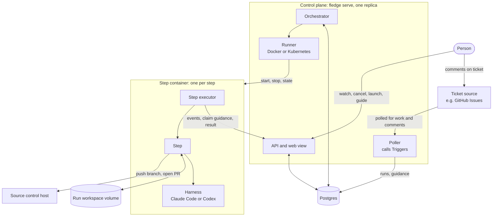

# Fledge MVP architecture

Status: proposed. Scope: the smallest factory that works end to end. A ticket
goes in, an agent works on it, a pull request comes out, and a person can watch
and steer.

Build order: the first implementation is Docker only. The Kubernetes runner and
manifests are designed here and deferred to a follow-up task. The design keeps
both platforms in view so that task adds one runner and nothing else.

## Summary

Fledge is one control-plane process plus one short-lived container per step.

- The **control plane** (`fledge serve`) polls triggers, drives runs through
  their steps, and serves the API and web view. All of its state is in Postgres.
- Each **step** runs in its own container (`fledge step-exec`). Steps in one run
  share a workspace volume. The step container talks back to the control plane
  over HTTP to report events, collect guidance and post its result.
- The **runner** is the only platform-specific code: a Docker implementation
  first, and a Kubernetes implementation later, behind one small interface.

Choices made here, with the reason for each:

| Choice | Reason |
| --- | --- |
| Python 3.13, one package (`fledge`) | The repo is already set up for it, and extension authors write plain Python classes. |
| Workflows are Python objects: an ordered list of steps | Steps are already Python, so a second definition language would be a second thing to learn and to design. Linear only. |
| Extensions are found through Python entry points | Standard library mechanism, no plugin framework. Built-ins register the same way as user code. |
| One image for the control plane and every step | Guarantees the control plane and the step container see the same workflows. Teams extend it with `FROM`. |
| Step containers report over HTTP, not by connecting to Postgres | Keeps database credentials out of the container the agent runs in, and makes Docker and Kubernetes behave the same. |
| A per-run workspace volume shared by the run's steps | Steps hand work to each other on disk. Nothing is pushed until the one step whose job is to publish. |
| Postgres is also the queue | Runs are rows with a status. No broker. |
| Single control-plane replica | Removes leader election and locking. The loop is a reconciler, so a restart resumes from the database. |
| GitHub only for the built-in trigger and the built-in pull request step | One working path. Other trackers and hosts are custom triggers and steps. |
| FastAPI, psycopg 3, plain SQL migrations, server-rendered HTML | Small, typed, no ORM and no frontend build. |

Proposed dependencies (none are added yet; each needs sign-off): `fastapi`,
`uvicorn`, `jinja2`, `psycopg`, `pydantic`, `httpx`, `docker`. The Kubernetes
task adds `kubernetes`.

## 1. Components

| Component | Responsibility | Extension point? |
| --- | --- | --- |
| Trigger | Finds outside work to react to by polling, fetches one ticket on request, and finds new human comments on a ticket. | Yes |
| Workflow | A named, ordered list of steps for one kind of work. | Yes |
| Step | One unit of work, run in a container against the run's workspace. | Yes |
| Harness | Adapter around one coding agent CLI. Runs one agent turn and can resume the same session. | Yes |
| Poller | Calls each configured trigger on an interval. Creates runs for new work and guidance rows for new comments. | Fixed |
| Orchestrator | Reconcile loop. Starts pending runs up to the concurrency limit, starts the next step, records outcomes, handles cancel and timeouts. | Fixed |
| Runner | Creates the run workspace, starts and stops step containers, reports container state. Docker first; Kubernetes deferred. | Fixed |
| Step executor | Entrypoint inside the step container (`fledge step-exec`). Loads the step, builds its context, runs it, reports the result. | Fixed |
| API and web view | Public API for runs, cancel, guidance and manual launch. Internal API for step containers. The web view is a thin page over the public API. | Fixed |
| Store | Postgres schema and queries. | Fixed |
| CLI | `fledge serve`, `fledge step-exec`, `fledge migrate`, `fledge submit`. | Fixed |

Shipped extensions:

- Trigger: `github_issues` (open issues in one repo carrying a configured label).
- Steps: `CloneRepo`, `AgentStep`, `OpenPullRequest`.
- Harnesses: `claude_code`, `codex`.
- Workflow: `ticket_to_pr` = `CloneRepo`, `AgentStep` (implement), `OpenPullRequest`.

## 2. How the components interact



### Life of a run

1. **Detect.** The poller calls `poll()` on each configured trigger. For each
   returned work item it inserts a `pending` run unless a run already exists for
   the same trigger and external id. A manual launch (web box or
   `fledge submit`) calls the trigger's `fetch()` and always inserts a run.
2. **Start.** The orchestrator promotes `pending` runs to `running` while fewer
   than `max_concurrent_runs` are running, oldest first, and asks the runner to
   create the run's workspace.
3. **Step.** For the run's next step, the orchestrator inserts a `step_runs` row
   with a fresh token and asks the runner to start a container. The container
   gets three settings (API URL, step run id, token) plus the configured
   secrets.
4. **Execute.** Inside the container, the step executor fetches its context from
   the internal API (work item, workflow name, step index, earlier step
   outputs), loads the step from the workflow, and calls `step.run(ctx)`. Log
   lines and harness events are posted back as events.
5. **Report.** The executor posts the step's result (outputs, or an error) and
   exits. The orchestrator sees the result in Postgres and starts the next step.
   If the container exits without a result, or exceeds `step_timeout`, the step
   and the run are marked failed.
6. **Finish.** After the last step succeeds the run is `succeeded`. On any
   terminal status the runner deletes the workspace. Step outputs are shown on
   the run page; the pull request URL is one of them.

There is no retry. A failed run stays failed; a person can launch a new run for
the same ticket by hand.

### Steering

Guidance has two entry points and one path after that.

- From the web view: `POST /api/runs/{id}/guidance` inserts a guidance row.
- From where the work originated: while a run is active, the poller calls the
  trigger's `poll_guidance()` for that ticket and inserts a row for each new
  comment (deduplicated on the comment's external id).

`AgentStep` delivers it. After each harness turn it claims the run's undelivered
guidance from the internal API. If there is any, it runs another turn in the
same harness session with the guidance as the prompt, and repeats until a turn
ends with nothing pending. A **turn** is one headless invocation of the agent
CLI, which runs until the agent stops and yields. There is no mid-turn
interruption.

Guidance that arrives when no agent turn will follow (for example during
`OpenPullRequest`) stays undelivered, and the run page shows it as such.

### Cancel

`POST /api/runs/{id}/cancel` sets `cancel_requested`. On its next tick the
orchestrator stops the active step container, marks the step and run
`cancelled`, and deletes the workspace.

### Restart behaviour

The orchestrator holds no state in memory. Container and volume names are
derived from step run and run ids, so after a control-plane restart the loop
finds running containers again by name and carries on. Step containers retry
their HTTP calls for a short period so a restart does not fail the step.

### Data model

Five tables. Ids are `uuid`, times are `timestamptz`.

| Table | Columns that matter |
| --- | --- |
| `runs` | `id`, `trigger`, `external_id`, `origin` (`poll` or `manual`), `workflow`, `title`, `body`, `url`, `repo_url`, `status` (`pending`, `running`, `succeeded`, `failed`, `cancelled`), `cancel_requested`, `error`, `created_at`, `started_at`, `finished_at` |
| `step_runs` | `id`, `run_id`, `index`, `name`, `status`, `output` (`jsonb`), `error`, `token_hash`, `started_at`, `finished_at` |
| `events` | `id` (`bigserial`), `run_id`, `step_run_id`, `at`, `kind` (`log`, `agent`, `state`), `message` |
| `guidance` | `id`, `run_id`, `source` (`web` or `trigger`), `external_id`, `author`, `body`, `created_at`, `delivered_at`; unique on (`run_id`, `external_id`) |
| `schema_migrations` | `version`, `applied_at` |

The work item is stored on the run rather than in its own table: the MVP never
needs a work item without a run.

### API

Public, used by the web view and the CLI:

| Method and path | Purpose |
| --- | --- |
| `GET /api/runs` | List runs, newest first. |
| `GET /api/runs/{id}` | One run with its steps, outputs and guidance. |
| `GET /api/runs/{id}/events?after={event_id}` | Events after a cursor. The page polls this. |
| `POST /api/runs` | Launch by hand: `{"trigger": "...", "ref": "..."}`. |
| `POST /api/runs/{id}/cancel` | Request cancel. |
| `POST /api/runs/{id}/guidance` | Add guidance: `{"body": "..."}`. |

Internal, used by step containers, authenticated with the per-step-run bearer
token:

| Method and path | Purpose |
| --- | --- |
| `GET /internal/step-runs/{id}` | The step's context. |
| `POST /internal/step-runs/{id}/events` | Append events. |
| `POST /internal/step-runs/{id}/guidance/claim` | Return the run's undelivered guidance and mark it delivered. |
| `POST /internal/step-runs/{id}/result` | Report success with outputs, or failure with an error. |

The web view is two server-rendered pages: a run list with the launch box, and a
run page with step status, the event log, a cancel button and the guidance box.
A few lines of script poll the events endpoint. No frontend build.

## 3. Extension point interfaces

Extensions are plain Python in an installed package, registered under entry
point groups in that package's `pyproject.toml`:

```toml
[project.entry-points."fledge.triggers"]
github_issues = "fledge.builtin.triggers.github_issues:GitHubIssuesTrigger"

[project.entry-points."fledge.workflows"]
ticket_to_pr = "fledge.builtin.workflows.ticket_to_pr:ticket_to_pr"

[project.entry-points."fledge.harnesses"]
claude_code = "fledge.builtin.harnesses.claude_code:ClaudeCodeHarness"
codex = "fledge.builtin.harnesses.codex:CodexHarness"
```

Steps have no registry. A step is only ever reached through the workflow that
contains it.

### Trigger

Runs in the control plane, so its methods are async.

```python
@dataclass(frozen=True)
class WorkItem:
    external_id: str   # stable id within this trigger, e.g. the issue number
    title: str
    body: str
    url: str           # link back to the ticket
    repo_url: str      # repository to clone and open the pull request against


@dataclass(frozen=True)
class Comment:
    external_id: str
    author: str
    body: str


class Trigger(Protocol):
    async def poll(self) -> list[WorkItem]:
        """Work that currently qualifies. Returning an item again is harmless."""

    async def fetch(self, ref: str) -> WorkItem:
        """One specific item, for a manual launch."""

    async def poll_guidance(
        self, item_external_id: str, since: datetime
    ) -> list[Comment]:
        """Human comments on the item made after `since`."""
```

`poll()` is stateless on purpose: the factory deduplicates on
(`trigger`, `external_id`), so a trigger keeps no cursor. `since` is the run's
start time, and comments are deduplicated on their external id.

A trigger instance is declared in `fledge.toml`. `name` identifies the instance,
`type` is the entry point name, `workflow` names the workflow its runs use, and
the remaining keys are passed to the trigger's constructor as keyword arguments:

```toml
[[trigger]]
name = "api-issues"
type = "github_issues"
workflow = "ticket_to_pr"
repo = "acme/api"
label = "fledge"
```

### Workflow

```python
@dataclass(frozen=True)
class Workflow:
    name: str
    steps: Sequence[Step]
```

A workflow is a value, not a subclass. Step names must be unique within it.
This example uses a different harness per step:

```python
review_then_pr = Workflow(
    name="review_then_pr",
    steps=[
        CloneRepo(),
        AgentStep(name="implement", harness="claude_code", prompt=IMPLEMENT),
        AgentStep(name="review", harness="codex", prompt=REVIEW_AND_FIX),
        OpenPullRequest(),
    ],
)
```

Steps run in order, each exactly once. No branching, loops or parallelism.

### Step

Runs in its own container, so it is synchronous.

```python
class Step(Protocol):
    name: str

    def run(self, ctx: StepContext) -> dict[str, str]:
        """Do the work. Return outputs for later steps. Raise to fail the run."""


class StepContext(Protocol):
    run_id: UUID
    work: WorkItem
    workspace: Path                       # shared by all steps of the run
    outputs: Mapping[str, Mapping[str, str]]   # earlier outputs, by step name

    def log(self, message: str) -> None: ...
    def agent_event(self, message: str) -> None: ...
    def claim_guidance(self) -> list[str]: ...
    def harness(self, name: str) -> Harness: ...
```

The built-in steps:

- `CloneRepo` clones `work.repo_url` into the workspace.
- `AgentStep(name, harness, prompt)` formats `prompt` with the work item's
  fields, runs harness turns with the guidance loop described above, and
  returns the agent's final message as `summary`.
- `OpenPullRequest` creates a branch named after the run, commits anything
  uncommitted, pushes, and opens a pull request that links the ticket. It
  returns `pull_request_url` and `head_sha`, and fails if there is no change.

### Harness

Runs inside the step container, next to the agent CLI it wraps.

```python
@dataclass(frozen=True)
class TurnResult:
    session_id: str      # pass back to continue the same conversation
    final_message: str


class Harness(Protocol):
    def run_turn(
        self,
        workspace: Path,
        prompt: str,
        session_id: str | None,
        on_event: Callable[[str], None],
    ) -> TurnResult:
        """Run the agent until it yields. Raise if the agent fails."""
```

`session_id` is `None` on the first turn. `on_event` receives human-readable
progress lines, which become `agent` events in the web view.

Both shipped harnesses run their CLI in headless mode with a streamed JSON
output, and use the CLI's resume option for later turns. They run with the CLI's
permission prompts disabled; the container is the boundary. The exact flags are
to be confirmed against the current CLIs during implementation.

A harness needs its CLI present in the image. The base image ships both.

### What an extension author does

1. Write a package with triggers, steps, harnesses or workflows and declare the
   entry points.
2. Build an image `FROM` the Fledge base image that installs the package and
   any toolchains the target repositories need.
3. Point `fledge.toml` at the trigger type and workflow name.

## 4. Deployment

One image runs everywhere. `fledge serve` is the control plane and
`fledge step-exec` is the step container's command. Configuration is one file,
`fledge.toml`, plus `DATABASE_URL` and secrets in the environment:

```toml
image = "ghcr.io/acme/fledge-acme:1"
api_url = "http://fledge:8000"   # where step containers reach the control plane
docker_network = "fledge"        # network step containers join
max_concurrent_runs = 1
poll_interval_seconds = 30
step_timeout_minutes = 60
step_secrets = ["ANTHROPIC_API_KEY", "OPENAI_API_KEY", "GITHUB_TOKEN"]
```

Schema migrations are numbered SQL files applied by `fledge migrate`, which
`fledge serve` runs at startup.

### Local Docker

A `compose.yaml` with two services: `postgres` and `fledge`. The `fledge`
service mounts the Docker socket and `fledge.toml`, and reads secrets from
`.env`. The Docker runner creates one named volume per run and one container
per step, attached to the compose network so steps can reach the control plane
by service name.

The local flow:

1. `docker compose up` starts Postgres and the factory. The web view is on
   `localhost:8000`.
2. Either label issues so the trigger picks them up, or name them:
   `fledge submit --trigger api-issues 12 14 15`. `submit` is a thin client for
   `POST /api/runs`.
3. Runs queue as `pending` and are worked through `max_concurrent_runs` at a
   time. The web view shows each run's steps and live events.

No Kubernetes is involved at any point.

### Kubernetes (designed, deferred)

Not part of the first implementation. This section is the target the Docker
build must not rule out. The Kubernetes task also adds a `runner` key to
`fledge.toml` to choose the platform.

Plain manifests, applied with `kubectl apply -k`:

- A `Deployment` with one replica running `fledge serve`, and a `Service`.
- A `ConfigMap` holding `fledge.toml`.
- A `Secret` holding `DATABASE_URL` and the step secrets.
- A `ServiceAccount` with a namespaced `Role` allowing it to manage `Jobs` and
  `PersistentVolumeClaims` and read `Pods`.

Postgres is supplied by the team; Fledge only needs the URL. The Kubernetes
runner creates one `PersistentVolumeClaim` per run and one `Job` per step
(`backoffLimit: 0`), in the control plane's namespace. Steps in a run are
sequential, so a `ReadWriteOnce` claim is enough. The web view is reached
through whatever ingress or port-forward the team already uses.

### What differs

| Concern | Docker | Kubernetes |
| --- | --- | --- |
| Step container | Container via the Docker socket | `Job` with one pod |
| Run workspace | Named volume | `PersistentVolumeClaim` from the default storage class |
| Step reaches control plane | Compose network, service name | `Service` DNS name |
| Step secrets | Values copied from the control plane's environment | `envFrom` the `Secret`; values never pass through the control plane |
| Postgres | Bundled in `compose.yaml` | Supplied by the team |
| Control plane's platform access | Docker socket mount | `ServiceAccount` and `Role` |

Everything else is the same code: poller, orchestrator, API, step executor,
steps and harnesses do not know which platform they are on. The runner
interface is the whole difference:

```python
class Runner(Protocol):
    async def create_workspace(self, run_id: UUID) -> None: ...
    async def start_step(self, spec: StepSpec) -> None: ...
    async def step_state(self, step_run_id: UUID) -> ContainerState: ...
    async def stop_step(self, step_run_id: UUID) -> None: ...
    async def delete_workspace(self, run_id: UUID) -> None: ...
```

This is an internal seam, not a supported extension point. The first
implementation has only the Docker runner, and it must stay within these five
operations: no host bind mounts, no reading results from container logs, and
no state kept outside Postgres and the workspace volume. Those shortcuts are
what would turn the Kubernetes runner into a rewrite.

## 5. Risks and open questions

Risks:

1. **Guidance latency.** Guidance lands only when a harness invocation ends,
   and an agent can work for a long time before yielding. This is accepted for
   the MVP. Delivering at the agent's internal turn boundaries would need
   streaming input, which the two CLIs support differently, and would change
   the harness interface.
2. **Anyone who can comment can steer.** Ticket comments become agent prompts.
   On a public tracker that is a prompt-injection path. The MVP does not filter
   by author.
3. **Secrets sit in the agent's container.** Every step container gets every
   step secret, including the token that can push. This is the out-of-scope
   credential work; see below.
4. **No authentication on the web view or public API.** Safe on localhost; on
   Kubernetes it relies on the team's ingress. Cancel and guidance are
   unauthenticated writes.
5. **Docker socket mount.** The local control plane has full control of the
   host's Docker daemon.
6. **Single replica.** A control-plane outage pauses polling and step
   scheduling. Running steps continue and are picked up again on restart, but
   only if the restart is within the step containers' retry window.
7. **One image for everything.** Teams with several repositories need one image
   holding every toolchain. Simple now, heavy later.
8. **Polling cost.** One comment query per active run per interval. Fine at MVP
   scale; rate limits will bite with many concurrent runs.
9. **Workspace storage on Kubernetes.** A claim per run depends on a working
   default storage class and on prompt cleanup; leaked claims cost money.
10. **Harness CLI drift.** The harnesses depend on CLI flags and output formats
    that change between releases. The image must pin CLI versions.
11. **Event volume.** Agent output is stored as rows. A chatty agent produces
    many; there is no retention policy.

Open questions:

1. Should ticket guidance be limited to certain authors in the MVP, given
   risk 2?
2. Should the factory write back to the ticket (run started, pull request
   link)? It is left out; the pull request links the ticket, which most
   trackers surface.
3. Should a polled ticket that failed be picked up again if it still
   qualifies? Today it is not; a person relaunches by hand.
4. Is requiring a team-supplied Postgres on Kubernetes acceptable, or should
   the manifests include one for trials?

## 6. Left out, as candidate follow-up tasks

Out of scope by instruction, with where each touches this design:

- **Verification and merge approval.** A run ends when the pull request is
  opened, and `succeeded` means only that. Verification would be more steps in
  the workflow list or a process that starts from the pull request; neither
  needs a change to the interfaces above.
- **Credential isolation and safe publishing.** `OpenPullRequest` is the only
  step that writes to source control, and `step_secrets` is the only place
  secrets are handed out. Scoping secrets per step, or moving the push out of
  agent-reachable containers, changes those two places.
- **Tying approvals to commits.** `OpenPullRequest` already returns `head_sha`
  as an output for a later approval mechanism to bind to.

Designed here and deferred:

- **Kubernetes runner and manifests**, as described in section 4.

Left out by choice:

1. Inbound webhooks for triggers.
2. Retry and resume of failed steps or runs.
3. Branching, loops, parallel steps and human approval gates in workflows.
4. Per-step images and per-step resource limits.
5. Mid-turn interruption or streaming guidance into a running agent.
6. Writing status back to the ticket.
7. Authentication, users and roles for the web view and API.
8. More triggers (Linear, Jira, GitLab) and other source control hosts.
9. Launching a run from free text with no ticket.
10. Multiple control-plane replicas.
11. Following up on a pull request after it opens (review comments, failing
    checks).
12. Cost and token accounting per run.
13. Event retention, log export, metrics and tracing.
14. A Helm chart.
15. A declarative (non-Python) workflow format.
16. Cancelling a run from the ticket.
